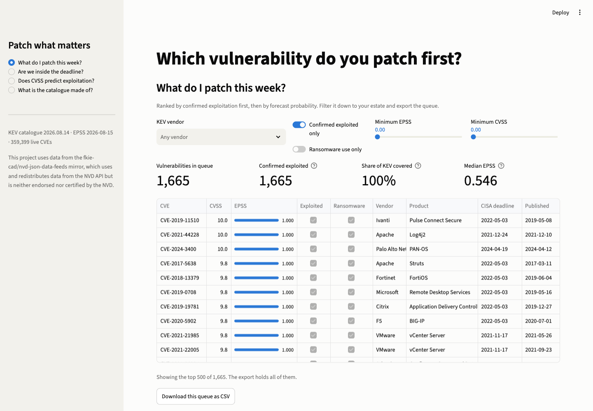
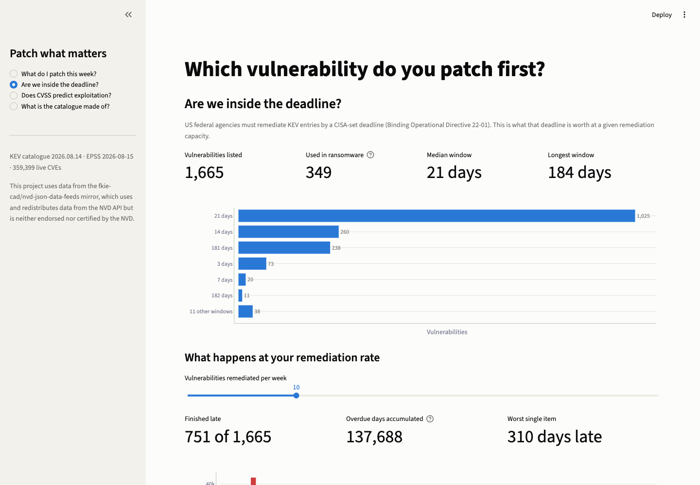
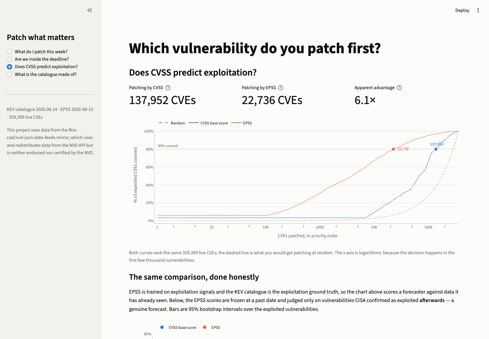
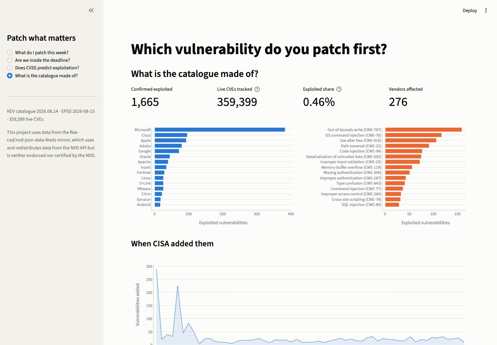

# Which vulnerability do you patch first?

A vulnerability prioritisation dashboard over three public feeds — the **CISA KEV** catalogue,
**EPSS** exploit-probability scores and the **NVD** — and a measurement of whether the metrics it
draws are worth anything.

**Skills demonstrated:** risk-based vulnerability prioritisation · KEV / EPSS / CVSS · BOD 22-01
remediation SLAs · API and bulk-feed ingestion · data contracts and schema testing · statistical
evaluation with confidence intervals · stakeholder-ready dashboards · Python, pandas, Streamlit.

<!-- BEGIN GENERATED: figures come from data/processed/analysis.json -->

> Ranking 359,399 live CVEs by CVSS means patching **137,952** of them to cover 80 % of what attackers actually exploit. Ranking by EPSS gets there with **22,736** — **6.1× less work**.

> Freeze the scores and measure only what was exploited *afterwards*, and most of that advantage disappears.

### The comparison everyone quotes

CVEs that must be patched to cover a given share of the 1,665 vulnerabilities CISA has confirmed exploited:

| Ranked by | 50 % covered | 80 % covered | 90 % covered |
|---|---:|---:|---:|
| CVSS base score | 68,835 | 137,952 | 196,334 |
| EPSS | 3,850 | 22,736 | 51,162 |
| Random | 179,700 | 287,519 | 323,459 |

Put the other way round: patching every one of the **47,253** CVEs rated CVSS ≥ 9.0 catches **35%** of what is exploited. Spending that same effort on the top 47,253 by EPSS catches **89%**.

### The comparison done honestly

EPSS is trained on exploitation signals and the KEV catalogue *is* the exploitation ground truth, so the table above scores a forecaster against data it has already seen. Below, EPSS is frozen at a past date, the universe is rewound to what existed then, and the only vulnerabilities that count are the ones CISA confirmed exploited **afterwards**:

| Scores frozen at | Universe | Later exploited | Budget | CVSS caught | EPSS caught | EPSS 95 % CI | Effort to 80 % |
|---|---:|---:|---:|---:|---:|---|---:|
| 2023-08-15 | 209,676 | 143 | 31,186 | 36% | 52% | 43%–59% | 0.7× |
| 2024-02-15 | 224,656 | 133 | 33,719 | 33% | 50% | 41%–58% | 0.7× |
| 2024-08-15 | 245,116 | 139 | 35,700 | 36% | 43% | 35%–52% | 0.6× |
| 2025-02-15 | 266,600 | 112 | 37,778 | 29% | 37% | 28%–46% | 0.5× |
| 2025-08-15 | 289,890 | 86 | 39,980 | 30% | 55% | 44%–65% | 0.7× |

Two results, and both hold at **every** cutoff:

1. **EPSS really does win at the head of the queue.** Same budget, 1.2–1.8× the later-exploited vulnerabilities caught.
2. **The 6.1× headline is mostly measurement artefact.** With frozen scores, EPSS needs *more* work than CVSS to reach 80 % coverage — effort ratio at most 0.7× — because its tail buries a real share of what later gets exploited.

So the queue this dashboard ranks is neither: confirmed exploitation first, EPSS for the head of the list, and CVSS kept as the guard on the tail.

*Data: CISA KEV catalogue 2026.08.14, EPSS 2026-08-15 (model v2026.06.15), NVD via the fkie-cad mirror. Regenerate with `make data`.*

<!-- END GENERATED -->

---

## The dashboard

Four views, each answering the question printed at the top of it. No chart exists for decoration.

### 1. What do I patch this week?

The queue, ranked by the hybrid policy the measurement argues for: confirmed exploitation first,
ransomware use above the rest of it, then forecast probability, with CVSS shown alongside rather
than driving the order. Filterable by vendor, severity and probability, and exportable as CSV —
the artefact a stakeholder actually asks for.



### 2. Are we inside the deadline?

US federal agencies must remediate KEV entries by a CISA-set deadline (Binding Operational
Directive 22-01). CISA does not draw those deadlines from a distribution — it picks from seventeen
fixed windows, and three of them cover 92 % of the catalogue. The slider then runs the queue at a
chosen remediation rate and reports what that capacity costs in overdue days.



### 3. Does CVSS predict exploitation?

The finding, with its own evidence: effort-versus-coverage curves for both strategies against a
random baseline, then the same comparison with the scores frozen and judged only on what was
exploited afterwards.



### 4. What is the catalogue made of?

Which vendors, which weakness classes, and when CISA added them.



---

## How the measurement works

**Ties are averaged, never broken.** Tens of thousands of CVEs share a CVSS base score of exactly
9.8, so the order *inside* that block decides the answer. An implementation that lets `sort` settle
it is measuring the alphabetical order of CVE identifiers. Each block of equal scores is scored as
its expected value under uniformly random ordering within the block, which is the only reading that
describes a real defender. `tests/test_metrics.py` guards this, and the guard ships with a negative
control proving it fails when the averaging is removed.

**Missing scores sort last** for every strategy, so no strategy is flattered by absent data.

**Uncertainty is bootstrapped over the positives** — 2,000 resamples, seed pinned — because with
86 to 143 confirmed-exploited CVEs per cutoff, that small number is where the sampling noise lives,
not in the 300,000-row universe.

**The random baseline is always plotted.** Without it, the two curves have no scale.

## Limitations, stated rather than buried

1. **KEV is biased and incomplete.** It is what CISA has confirmed and published, not what is
   exploited. Absence from KEV is not evidence of safety.
2. **CVSS scores are read as of today, not frozen at the cutoff**, because the mirror carries no
   score history. That hands CVSS an advantage in the prospective test — and it still loses at the
   head of the queue, so the direction of the finding survives the caveat.
3. **Small positive counts.** Hence intervals on every prospective claim, and no claim made from a
   single cutoff.
4. **Vulnerabilities published after a cutoff are excluded** from that run. Neither strategy can
   rank a CVE that does not exist yet; this is a statement about triaging a backlog, not about
   zero-days.

## Data sources

| Source | What it gives | Notes |
|---|---|---|
| [CISA KEV](https://www.cisa.gov/known-exploited-vulnerabilities-catalog) | Vulnerabilities confirmed exploited, with remediation deadlines | One request, no key |
| [EPSS](https://www.first.org/epss/) (FIRST) | Probability of exploitation in the next 30 days | Daily dump plus dated archives, which is what makes the frozen-score test possible |
| [NVD](https://nvd.nist.gov/) via [fkie-cad/nvd-json-data-feeds](https://github.com/fkie-cad/nvd-json-data-feeds) | The full CVE catalogue with CVSS metrics | The official API cannot serve the full catalogue: 189 pages at a measured 255 s each, on a connection that dribbles bytes so socket timeouts never fire. The mirror serves the same schema in 12 seconds. |

This project uses data from the fkie-cad/nvd-json-data-feeds mirror, which uses and redistributes
data from the NVD API but is **neither endorsed nor certified by the NVD**.

Raw feeds are not committed — 116 MB compressed, 3 GB expanded. `data/raw/MANIFEST.json` **is**
committed: it records the URL, size, SHA-256 and record count of every file that produced the
published numbers, so a later reader can tell whether they are looking at the same bytes.

## Reproduce it

```bash
make venv      # Python 3.12 environment from pinned requirements
make data      # fetch the feeds, join them, compute every published number
make test      # 75 tests, no network access
make app       # serve the dashboard at localhost:8501
```

`make data` takes about a minute end to end: the feeds are 116 MB, the full NVD extract runs in
20 seconds, and the analysis in 2.

## Repository layout

```
src/ingest.py     fetch the feeds, with a throughput watchdog and a manifest
src/extract.py    walk the NVD year by year; the CVSS selection rule lives here
src/build.py      join the three feeds into one committed Parquet table
src/metrics.py    the coverage curve and its tie handling
src/analyse.py    every published number, into analysis.json
src/viz.py        chart construction, colour assignment fixed per entity
app.py            the four views
tests/            75 tests; fixtures are trimmed real payloads
docs/specs/       the specification this was built from
docs/adr/         decisions, with what was rejected and why
```

## Tests

75 tests, none of which touch the network — a fixture-level guard fails any test that opens a
socket. Fixtures are real payloads trimmed to a dozen CVEs, chosen to exercise the branches that
matter: a CVE with no score at all, a rejected identifier, one scored only on CVSS v2, one scored
only by its vendor, one carrying CISA's SSVC decision, a KEV entry the NVD has never heard of, and
a CVE absent from the EPSS dump.

The suite includes acceptance tests that pin the project's *claims*, not just its numbers: EPSS
must beat CVSS at the head of the queue at every cutoff, and must lose on total effort at every
cutoff. If a data refresh ever breaks either, the README has stopped being true and the tests say
so before anyone publishes.
